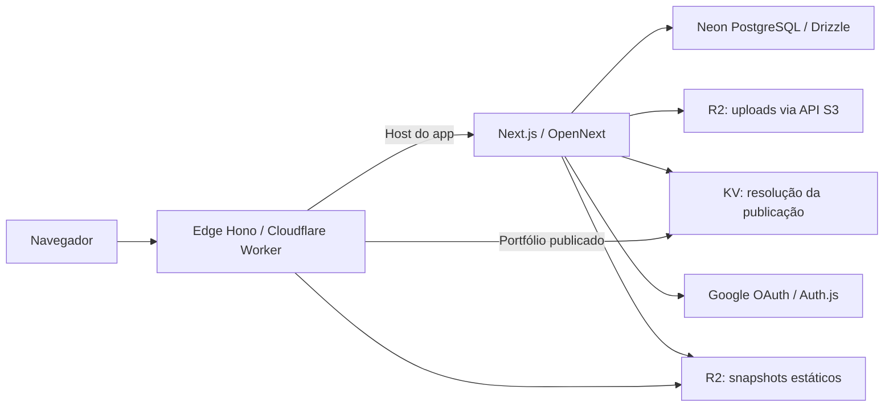

# Guia do projeto Folyo

Documentação do código presente em 15/10/2026. Os manifests e o lockfile são a referência das versões instaladas. Detalhes históricos e contratos extensos estão em [HISTORICO-TECNICO.md](HISTORICO-TECNICO.md).

## Produto e recursos

O usuário autentica com Google, aceita os termos, escolhe um handle e um template e edita seu portfólio. O dashboard reúne os acessos ao editor, templates, publicação e configurações. O editor oferece blocos, arrastar e soltar, atalhos, menu de inserção, edição inline, autosave, imagens, gerenciamento de páginas e controles de design. Preview de rascunho e publicação são fluxos separados. Há exclusão de portfólio/conta, denúncias, moderação, termos, privacidade e textos em português e inglês.

## Arquitetura

Em desenvolvimento, Next executa na porta 3000 e o Edge na 8787. O launcher passa as variáveis do domínio/ambiente para Wrangler. OpenNext inicializa os bindings locais; o projeto usa persistência Wrangler para KV e snapshots. Uploads usam credenciais S3 R2 reais, inclusive no desenvolvimento. O login deve ocorrer em localhost:3000.

Publicação gera HTML usando o mesmo render do preview, grava snapshots versionados no R2 e atualiza o KV. PostgreSQL registra versões e operações para serialização e recuperação. A leitura pública passa pelo Edge, sem renderizar novamente o editor. Consulte o histórico técnico para ordem de gravação, falhas parciais e recuperação de operações pendentes; não remova locks ou objetos manualmente sem avaliar referências.

## Organização

| Caminho                      | Responsabilidade                                                |
| ---------------------------- | --------------------------------------------------------------- |
| `apps/web/app`               | Páginas App Router e endpoints HTTP                             |
| `apps/web/components/editor` | Canvas, blocos, páginas, uploads e design                       |
| `apps/web/components/render` | Render compartilhado entre preview e publicação                 |
| `apps/web/lib`               | Serviços, repositórios, validação, sessão e internacionalização |
| `apps/web/lib/publish`       | Serviço, render, SEO, bindings e persistência da publicação     |
| `apps/edge/src/index.ts`     | Hosts, proxy do app e entrega pública de snapshots              |
| `packages/core/src`          | Contratos Zod, blocos, temas, templates, handles e utilitários  |
| `packages/db/src`            | Schema Drizzle, Neon, storage, migrations, seed e GC            |
| `packages/db/migrations`     | SQL, snapshots e journal versionados                            |
| `scripts/dev-edge.mjs`       | Inicialização do Edge em desenvolvimento                        |
| `.github/workflows/ci.yml`   | Lint, TypeScript, testes e build; sem deploy                    |
| `docs/audits`                | Artefatos de auditoria existentes                               |

Tecnologias: Next.js 15, React 19, TypeScript 5, Auth.js 5 beta, Hono 4, Drizzle ORM, Neon serverless, Cloudflare Workers/R2/KV, OpenNext, Zod, dnd-kit e Vitest. Pacotes internos exportam TypeScript. O workspace é gerenciado por pnpm.

## Instalação e configuração

Use Node.js 22+ e pnpm 10.28.2. Instale com `pnpm install --frozen-lockfile`. Copie `.env.example` para `.env` apenas em uma instalação nova. Nunca substitua o arquivo restaurado sem guardar sua cópia.

| Variável                                   | Uso                                                    |
| ------------------------------------------ | ------------------------------------------------------ |
| `ROOT_DOMAIN`                              | Domínio raiz sem protocolo/porta; `lvh.me` em dev      |
| `ENVIRONMENT`                              | `dev`, `preview` ou `prod`                             |
| `SITE_EDGE_PORT`                           | Porta do Edge local; normalmente 8787                  |
| `APP_PUBLIC_URL`                           | Origem pública do app/assets                           |
| `DATABASE_URL`                             | URL PostgreSQL Neon com TLS                            |
| `AUTH_URL`                                 | Origem de autenticação; localhost:3000 em dev          |
| `AUTH_SECRET`                              | Segredo de sessão; mínimo de 32 caracteres             |
| `AUTH_GOOGLE_ID`, `AUTH_GOOGLE_SECRET`     | OAuth Web application Google                           |
| `R2_ACCOUNT_ID`                            | ID da conta Cloudflare                                 |
| `R2_ACCESS_KEY_ID`, `R2_SECRET_ACCESS_KEY` | Credenciais S3 para storage                            |
| `CRON_SECRET`                              | Bearer token do endpoint de coleta                     |
| `GC_GRACE_DAYS`                            | Carência para coleta de assets; exemplo: 7             |
| `ADMIN_EMAILS`                             | E-mails autorizados à moderação, separados por vírgula |
| `LEGAL_ENTITY_NAME`, `LEGAL_CONTACT_EMAIL` | Identificação do operador e contato legal              |

Crie/selecione um projeto Neon e use a URL de conexão do painel, com TLS. Em uma base nova, aplique `pnpm db:migrate` e `pnpm db:seed`. Não execute seed/migrations em produção sem revisar o destino e o SQL. Para evoluir o schema: editar `packages/db/src/schema.ts`, executar `pnpm db:generate`, revisar os arquivos gerados, aplicar migration e versionar SQL/meta/journal juntos.

No Google Cloud, configure consentimento e um cliente OAuth Web. A origem local é `http://localhost:3000`; callback: `http://localhost:3000/api/auth/callback/google`. Cadastre usuários de teste quando necessário. Ao trocar apenas o sistema operacional, mantendo a URL local, o callback permanece igual.

## Banco e persistência

| Tabela                   | Dados                                                             |
| ------------------------ | ----------------------------------------------------------------- |
| `users`                  | Identidade Google, e-mail, aceite de termos e locale              |
| `sites`                  | Site único por usuário, handle, tema, template e versão publicada |
| `pages`                  | Páginas ordenadas, slug único por site                            |
| `blocks`                 | Blocos ordenados e conteúdo JSON                                  |
| `assets`                 | Chaves R2, metadados e data de orfandade                          |
| `publications`           | Versões publicadas, prefixo R2 e referências de assets            |
| `reports`                | Denúncias e estado de moderação                                   |
| `reserved_handles`       | Handles bloqueados                                                |
| `publication_operations` | Operações de publicação em andamento                              |
| `site_deletions`         | Limpeza recuperável que sobrevive à exclusão do site              |

Relacionamentos e cascades estão definidos no schema. `updated_at` deve ser atualizado pela camada de escrita. Conteúdos JSON são validados pelos contratos do core. O banco é remoto; não há banco PostgreSQL completo dentro do repositório ou do backup local.

## Superfície HTTP e código de referência

Os métodos e schemas exatos estão nos arquivos `route.ts` em `apps/web/app/api`, com serviços e testes em `apps/web/lib`.

| Família                                                                                 | Finalidade                            |
| --------------------------------------------------------------------------------------- | ------------------------------------- |
| `/api/auth/[...nextauth]`                                                               | OAuth e sessões                       |
| `/api/account`, `/api/account/accept-terms`                                             | Conta e aceite                        |
| `/api/handle/check`, `/api/onboarding`                                                  | Disponibilidade e criação inicial     |
| `/api/editor`                                                                           | Carregamento do editor                |
| `/api/pages`, `/api/pages/reorder`, `/api/pages/[pageId]`, `/api/pages/[pageId]/blocks` | Gerenciamento de páginas e conteúdo   |
| `/api/upload`, `/api/assets/[...key]`                                                   | Upload e acesso a arquivos            |
| `/api/site`, `/api/site/theme`, `/api/site/favicon`                                     | Configurações e exclusão do portfólio |
| `/api/site/template`, `/api/site/template/style`                                        | Template e estilo                     |
| `/api/site/publish`, `/api/site/unpublish`                                              | Publicação e retirada                 |
| `/api/reports`, `/api/admin/reports/[id]`                                               | Denúncias e moderação                 |
| `/api/cron/assets-gc`                                                                   | Coleta diferida autenticada por token |

Páginas principais: `/`, `/dashboard`, `/editor`, `/templates`, `/settings`, `/onboarding`, `/accept-terms`, `/privacy`, `/terms`, `/report`, `/admin/reports`. O preview usa `/p/[siteId]/[[...slug]]`. Autorização de proprietário, sessão e payload são verificadas no servidor; consulte os testes correspondentes antes de alterar contratos.

## Comandos e qualidade

| Comando                          | Resultado                           |
| -------------------------------- | ----------------------------------- |
| `pnpm dev`                       | Next + Edge, com `.env`             |
| `pnpm dev:auth`                  | Apenas Next com ambiente carregado  |
| `pnpm lint`                      | ESLint                              |
| `pnpm typecheck`                 | TypeScript raiz e workspaces        |
| `pnpm test`                      | Suite Vitest                        |
| `pnpm build`                     | OpenNext web + dry run do Edge      |
| `pnpm --filter @folyo/web build` | Build Next isolado                  |
| `pnpm db:generate`               | Geração de migrations               |
| `pnpm db:migrate`                | Aplicação de migrations             |
| `pnpm db:seed`                   | Handles reservados                  |
| `pnpm storage:probe`             | Diagnóstico do R2 configurado       |
| `pnpm format`                    | Formatação com escrita nos arquivos |

A CI executa em PRs e pushes na main. Testes cobrem contratos, repositórios, serviços, roteamento, publicação, exclusão e componentes do editor. Em máquinas lentas, timeouts de testes de interface podem exigir repetição isolada para distinguir lentidão de falha funcional. A medição Lighthouse existente é histórica e não garante o desempenho de uma implantação futura.

## Cloudflare e produção

Os arquivos Wrangler de web e edge devem usar o mesmo KV `SITE_KV`, `ASSETS_BUCKET` e `SITES_BUCKET`. Os nomes atuais são `folyo-user-assets` e `folyo-published-sites`; o ID KV composto por zeros é placeholder e deve ser substituído para implantação real. `WEB` do Edge aponta para `folyo-web`, e o self binding web deve acompanhar seu nome.

Antes de publicar, configure recursos reais, domínio e rotas (incluindo subdomínios), ambiente, origens, OAuth de produção, secrets e identificação legal. O web precisa das variáveis de servidor e bindings; não coloque segredos em `NEXT_PUBLIC_` nem no Git. Publique primeiro web, depois edge. `pnpm --filter @folyo/web deploy` realiza build e deploy; o Edge pode ser publicado com `pnpm --filter @folyo/edge exec wrangler deploy`. Esses comandos alteram a nuvem; o build normal só faz dry run do Edge. A configuração atual não comprova que exista produção implantada.

Agende externamente o endpoint de GC usando seu bearer token, observando a carência e as referências a publicações. Não há scheduler configurado na CI.

## Diagnóstico

- Login falha: confira origem/callback Google, usuários de teste, `AUTH_URL`, secrets e uso consistente de localhost.
- Erro de banco: confira destino Neon, TLS, acesso à rede e migrations.
- Upload falha: confira as três variáveis R2, permissões e `pnpm storage:probe`. O bucket efetivo é definido pelo código/configuração de storage.
- Portfólio retorna 404: confira host/handle, estado publicado e persistência KV/R2; preview não publica.
- Porta ocupada: encerre a instância anterior ou ajuste configurações coerentemente.
- Novo SO: reinstale dependências e gere os builds nesse SO; preserve `.wrangler` e `.env`.

## Continuidade

Preserve acesso às contas GitHub, Google Cloud, Neon e Cloudflare, incluindo recuperação de MFA. Consulte [MIGRACAO-E-BACKUP.md](MIGRACAO-E-BACKUP.md) para restaurar o projeto. Pendências de implantação e decisões detalhadas permanecem no histórico técnico.
